# 🕹️ Polyglot Arcade

[](https://github.com/svierk/polyglot-arcade/actions/workflows/ci.yml)
[](https://github.com/svierk/polyglot-arcade/releases/latest)
[](LICENSE)

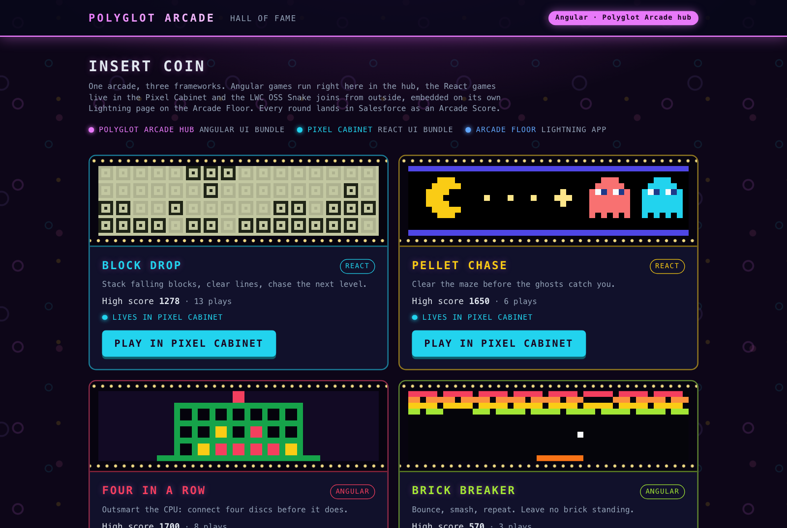

A retro arcade that runs on the Salesforce Platform and shows **Salesforce Multi-Framework** end to end: an **Angular** app and a **React** app live side by side in one org, share the same CRM data and embed into Lightning pages as **microfrontends** - next to an **LWC OSS** game that is hosted outside Salesforce altogether.

Every finished round is stored as an `Arcade_Score__c` record. Leaderboards, high scores and play counts are ordinary Salesforce data: sharing, field-level security and roll-up summaries do the work, no custom backend required.

## 💡 The idea

Salesforce Multi-Framework lets teams build Salesforce apps with the frameworks they already know. Business demos of it tend to look alike - a list, a form, a detail page. Games stress a framework differently: a game loop, canvas rendering, keyboard focus inside an iframe, state that has to survive a reload as CRM data.

Polyglot Arcade turns that into a playful reference project:

- **Three frameworks, one platform.** The arcade hub is Angular, the real-time games run in a React "cabinet", and the [LWC OSS Snake](https://github.com/svierk/lwc-oss-snake-game) joins from Vercel. Each framework is used where it fits.
- **CRM data as the score sheet.** Every round becomes a record - visible in the shipped reports and dashboard, in a native LWC leaderboard and in both apps.
- **Microfrontends in Lightning.** One host LWC drops any game onto a Lightning page, talks to it through events, and attributes rounds to the Account it is placed on. Games without a Salesforce session of their own get their score saved by the host.
- **One arcade, not three apps.** The Angular hub is the only lobby, the React cabinet is a machine it launches, and the Lightning app _Arcade Floor_ is where microfrontends are composed. A shared marquee bar and return links connect them.
- **You can see the architecture.** Every surface has its own color and room - a magenta arcade hall for the Angular hub, a cyan machine room for the React cabinet, blue for the Arcade Floor - and every game is a machine of its own. A switch between frameworks is something you see, not something you have to know.

## 🧩 Salesforce Multi-Framework in a nutshell

| Concept                             | What it means                                                                                                                                                                   | Where to look in this repo                                                                                                                                                                         |
| ----------------------------------- | ------------------------------------------------------------------------------------------------------------------------------------------------------------------------------- | -------------------------------------------------------------------------------------------------------------------------------------------------------------------------------------------------- |
| **UI bundle** (`UIBundle` metadata) | A React or Angular app built with its usual tooling, deployed as metadata and launched from the App Launcher on its own `*.salesforce.app` domain, isolated from Lightning      | [`uiBundles/polyglotArcade`](force-app/main/default/uiBundles/polyglotArcade) (Angular), [`uiBundles/pixelCabinet`](force-app/main/default/uiBundles/pixelCabinet) (React)                         |
| **Data SDK**                        | `createDataSDK()` from `@salesforce/platform-sdk`: UI API GraphQL queries and mutations with the user's session; object/field security and sharing are enforced by the platform | [`arcade-api.service.ts`](force-app/main/default/uiBundles/polyglotArcade/src/app/api/arcade-api.service.ts), [`arcadeApi.ts`](force-app/main/default/uiBundles/pixelCabinet/src/api/arcadeApi.ts) |
| **Microfrontend**                   | The `<lightning-ui-embedding>` base component frames an app inside an LWC on a Lightning page                                                                                   | [`arcadeGameHost`](force-app/main/default/lwc/arcadeGameHost)                                                                                                                                      |
| **View SDK**                        | Inside the frame, `getViewSDK()` reads the host's `props` and dispatches events back to the page                                                                                | [`hostBridge.ts`](force-app/main/default/uiBundles/pixelCabinet/src/embedding/hostBridge.ts)                                                                                                       |
| **Package-free bridge**             | The same host protocol without `@salesforce/platform-sdk` (`postMessage` handshake, then JSON-RPC over a `MessagePort`) for guests that cannot load the SDK                     | [`snake/embedding`](https://github.com/svierk/lwc-oss-snake-game/tree/main/src/modules/snake/embedding) in the Snake repo                                                                          |

React and Angular are generally available for UI bundles as of Winter '27. Embedding an **internally hosted** bundle (served from `*.salesforce.app`) is currently in beta and supports React; any **externally hosted** app can be embedded regardless of framework. That is why the embeddable games of the org live in the React cabinet - and why an LWC OSS app on Vercel can join as well.

## 🎮 Games

| Game              | Mechanic                                               | Framework | Lives in                             | Status      |
| ----------------- | ------------------------------------------------------ | --------- | ------------------------------------ | ----------- |
| **Block Drop**    | falling blocks, line clears, levels                    | React     | Pixel Cabinet                        | ✅ Playable |
| **Pellet Chase**  | maze chase: four ghosts with their own tactics         | React     | Pixel Cabinet                        | ✅ Playable |
| **Four in a Row** | turn-based vs. a minimax CPU with three difficulties   | Angular   | Polyglot Arcade hub                  | ✅ Playable |
| **Brick Breaker** | paddle and ball, tougher walls every level             | Angular   | Polyglot Arcade hub                  | ✅ Playable |
| **Snake**         | eat, grow, don't bite your own tail - on a retro phone | LWC OSS   | Vercel, embedded on the Arcade Floor | ✅ Playable |

> The games are original implementations of classic mechanics. Names and artwork are deliberately generic - no trademarks of the original arcade titles are used.

**Same hall, different machines.** Every game has a cabinet of its own, with its HUD, result screen and high-score card in its style:

| Game          | Machine                                                                                                            |
| ------------- | ------------------------------------------------------------------------------------------------------------------ |
| Pellet Chase  | Upright arcade cabinet: backlit marquee, CRT with scanlines, joystick panel, coin door, attract-screen high scores |
| Block Drop    | Handheld brick-game console: grey-olive LCD with segment digits, direction and rotate keys as touch controls       |
| Brick Breaker | 80s home console on a wood-grain CRT TV, with the cartridge box as high-score card                                 |
| Four in a Row | Tabletop toy: glossy frame on feet, discs that drop and bounce, the result on the lid of the game box              |
| Snake         | Retro phone with its own LCD; embedded, the Lightning page shows the part with the screen and the navigation keys  |

In the hub lobby every game card carries a teaser marquee in the look of its machine and says where the game lives.

| Four in a Row (Angular hub)                                                                                                                                            | Brick Breaker (Angular hub)                                                                                                                                          |
| ---------------------------------------------------------------------------------------------------------------------------------------------------------------------- | -------------------------------------------------------------------------------------------------------------------------------------------------------------------- |
| 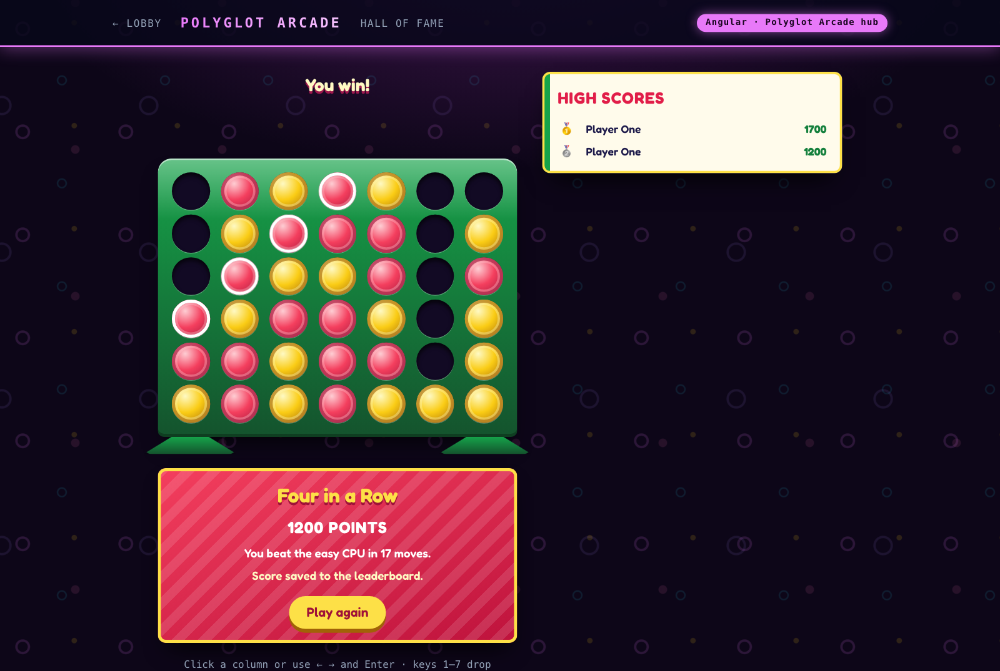 | 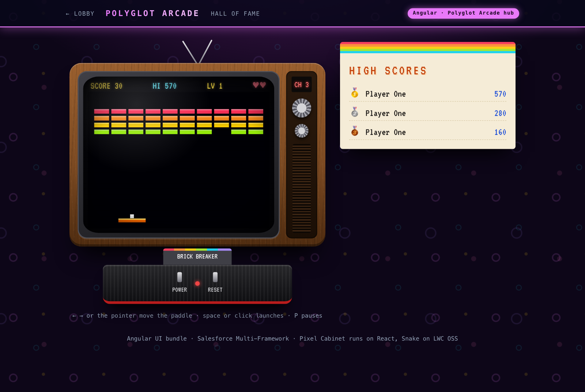 |
| **Block Drop (React cabinet)**                                                                                                                                         | **Pellet Chase (React cabinet)**                                                                                                                                     |
| 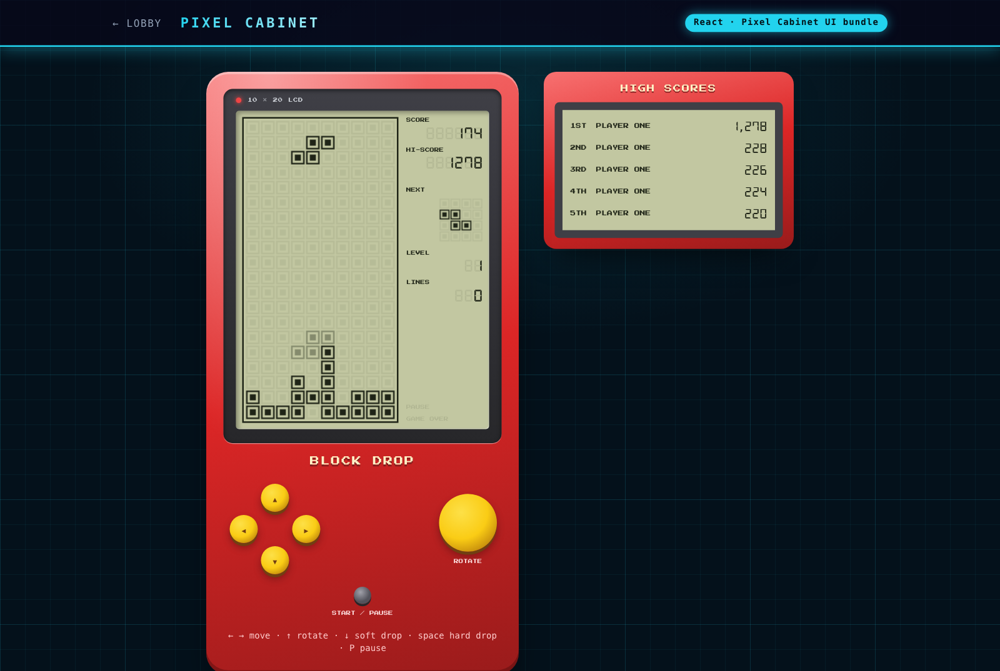           | 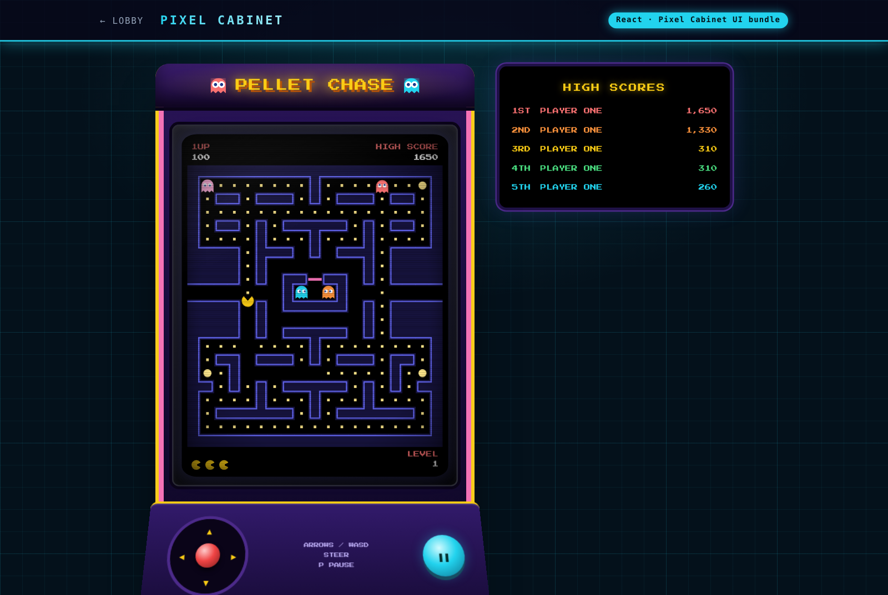       |
| **Microfrontend on a Lightning page**                                                                                                                                  | **Hall of fame across all surfaces**                                                                                                                                 |
| 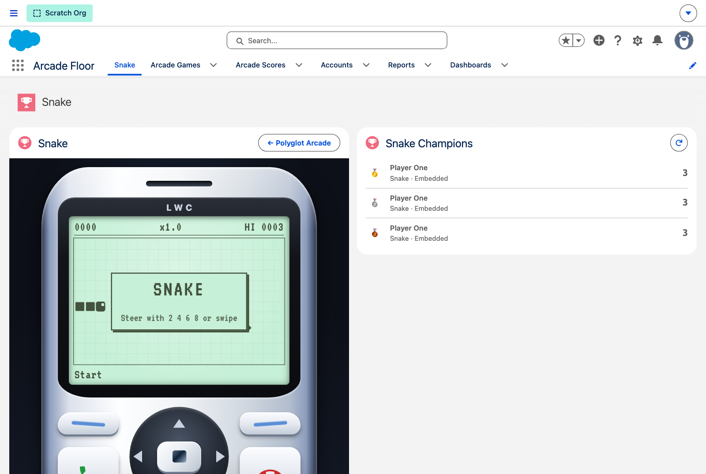             | 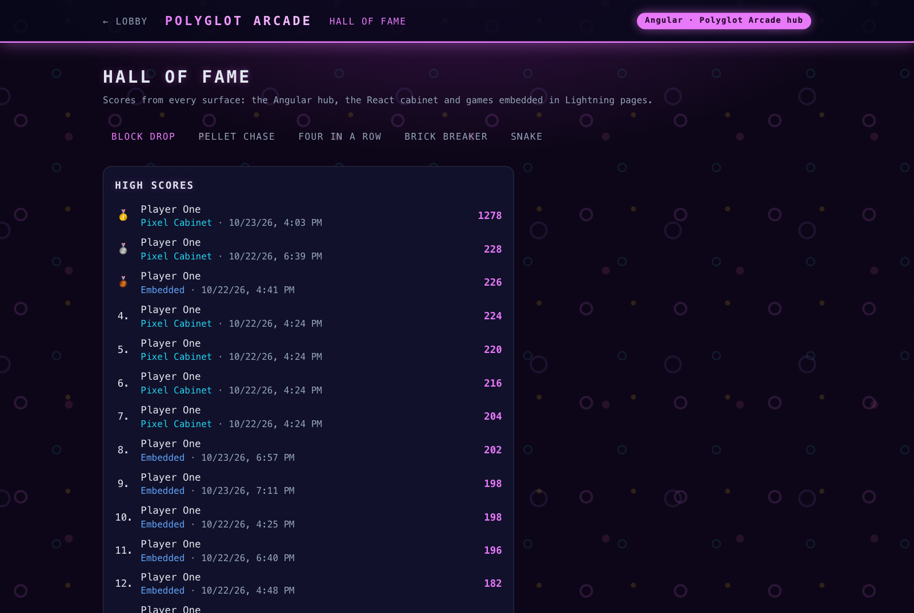                           |

## 🏗️ Architecture

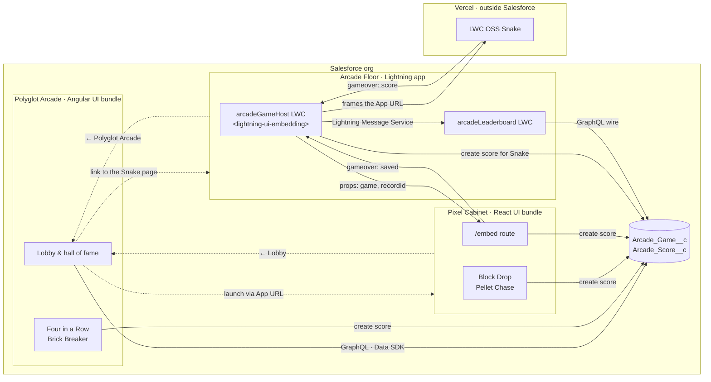

Every surface has one role (see [ADR 0001](docs/decisions/0001-surface-roles.md)) and a color of its own:

| Surface                                 | Color               | Role                                                                                                                                                                                                                                            |
| --------------------------------------- | ------------------- | ----------------------------------------------------------------------------------------------------------------------------------------------------------------------------------------------------------------------------------------------- |
| **Polyglot Arcade** (Angular UI bundle) | magenta arcade hall | The only lobby and hall of fame, and the entry point. It launches every game, wherever it lives.                                                                                                                                                |
| **Pixel Cabinet** (React UI bundle)     | cyan machine room   | A machine, not a second hub. It has no lobby: opening it sends the player to the hub lobby. The hub launches its games at `/play/<game>`, Lightning frames them at `/embed`.                                                                    |
| **Arcade Floor** (Lightning app)        | blue                | Where microfrontends are composed: the **Snake** page with the Snake and its leaderboard, and the **Arcade Account** record page (app default for Accounts) with the cabinet and the Account's leaderboard. Rounds there count for the Account. |

Every standalone page starts with the same marquee bar: `← Lobby` and a badge naming the surface (`Angular · Polyglot Arcade hub`, `React · Pixel Cabinet UI bundle`). The bar is laid out the same everywhere but glows in the color of its surface, and the room below it is the surface's own: the hub is a magenta arcade hall, the cabinet a cyan machine room. Lobby cards, launch buttons and the hall of fame use the same colors to say where a game lives and where a round was played, and the embedded cabinet carries a slim `React · Pixel Cabinet UI bundle` tag inside the Lightning frame. A switch between bundles is visible instead of feeling like a break (see [ADR 0002](docs/decisions/0002-surfaces-and-machines.md)). In Lightning, the host card links back with `← Polyglot Arcade`.

The demo covers four integration patterns:

1. **Native Angular UI bundle.** `polyglotArcade` launches from the App Launcher and reads and writes data with the Data SDK. The lobby is data driven: tiles, colors, high scores and launch targets come from `Arcade_Game__c`.
2. **Native React UI bundle.** `pixelCabinet` runs standalone the same way, with its own routes and leaderboard. It is launched from the hub lobby and has no lobby of its own.
3. **Internally hosted microfrontend - the guest saves.** The `arcadeGameHost` LWC frames the cabinet's `/embed` route. The cabinet has the user's session and saves the round itself. Admins pick the game in Lightning App Builder; on an Account record page such as **Arcade Account** every round is attributed to that Account.
4. **Externally hosted microfrontend - the host saves.** The same LWC frames the Snake on Vercel. The Snake has no Salesforce session, so it only reports the round and the host saves it with `createRecord`. The hub lobby links Snake to its page on the Arcade Floor, where it is played.

Which pattern applies comes from the game record: `App_Url__c` plus `Embed_Path__c` build the frame URL (`/embed` for the cabinet, nothing for the Snake), and `Host_Saves_Score__c` tells the host to save rounds itself.

What happens when an embedded cabinet round ends:

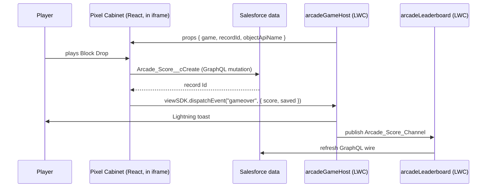

And when a Snake round ends:

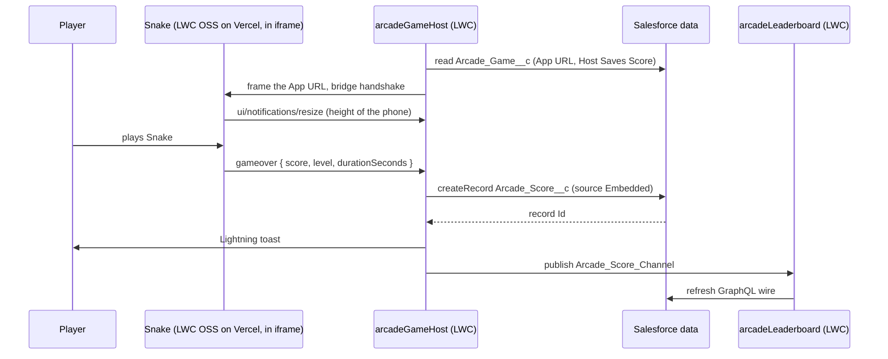

LWR, the runtime of LWC OSS, cannot load `@salesforce/platform-sdk`, so the Snake speaks the [package-free bridge](https://developer.salesforce.com/docs/platform/microfrontend/guide/package-free-bridge.html) directly; its [README](https://github.com/svierk/lwc-oss-snake-game#embedding-in-salesforce) has the details. The host saves a Snake round only for the game record it embeds and only with a whole, non-negative score. Like with any game that runs in the browser, the score itself is what the game reports.

Game rules live in framework-free TypeScript (`games/*/engine.ts`) with their own unit tests; the React and Angular components only render and handle input.

### Data model

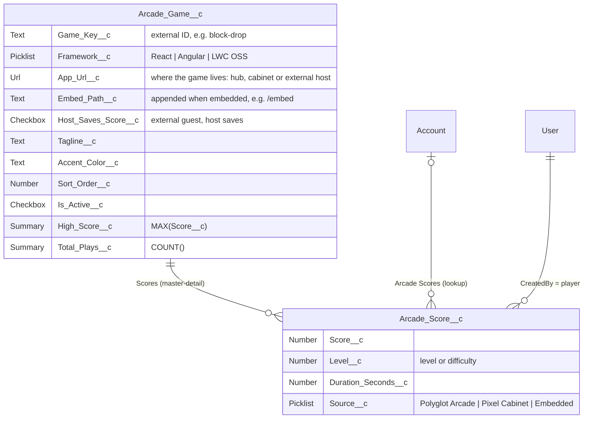

The permission set **Polyglot Arcade Player** (`polyglotArcade_Access`) grants the two UI bundle apps and Arcade Floor, read access to games and create/read access to scores. Players cannot edit or delete scores. Leaderboards only list scoring rounds; lost rounds still count as plays.

The report folder **Polyglot Arcade** holds three reports on the report type _Arcade Games with Scores_ - **Top scores per game**, **Plays per framework** and **Rounds per source** - and the dashboard **Arcade Floor** charts all three. Both folders are shared with all internal users, and the dashboard shows each viewer the data they can see. Arcade Floor has the Reports and Dashboards tabs.

## 🚀 Deploy to your org

### Prerequisites

- An org on **Winter '27** or later with Salesforce Multi-Framework - a scratch org, a Developer Edition or a sandbox
- For the microfrontend: a **Hyperforce** org with **English** as the default language (requirements of `lightning-ui-embedding`)
- **Salesforce Edge Network** enabled in My Domain, so the UI bundles open from the App Launcher (scratch orgs get it from the scratch org definition)
- [Salesforce CLI](https://developer.salesforce.com/tools/salesforcecli) and **Node.js 24**

`npm run setup` checks the org against this list before it deploys and prints a hint for every gap. The check only warns: an org without English as the default language still runs the hub and the cabinet, only embedding fails. Run it on its own with `npm run preflight -- --target-org my-org`.

### Option A: Scratch org

```bash
git clone https://github.com/svierk/polyglot-arcade.git
cd polyglot-arcade
npm install

sf org create scratch -f config/project-scratch-def.json -a polyglot-arcade -v <your-dev-hub> -y 7
npm run setup -- --target-org polyglot-arcade
```

### Option B: Any existing org

```bash
git clone https://github.com/svierk/polyglot-arcade.git
cd polyglot-arcade
npm install

sf org login web -a my-org        # Developer Edition, sandbox, ...
npm run setup -- --target-org my-org
```

`npm run setup` shows the steps it is about to run (confirm with Enter, or pass `--yes` to skip the picker) and then:

1. **Preflight** - checks the API version, Multi-Framework, default language, Hyperforce and Edge Network
2. **Build** - installs and builds both UI bundles
3. **Deploy** - deploys the metadata, including the reports and the dashboard
4. **Permission set** - assigns Polyglot Arcade Player to you
5. **Data** - upserts the five games by their **Game Key**. Existing games are updated in place, so their scores survive
6. **Connect** - stores the org-specific UI bundle URLs (read from their App Launcher entries) on the game records: the Pixel Cabinet URL and its `/embed` route on the React games, so the hub can launch them and the host LWC can embed them, and the hub URL on the Angular games, so the host LWC can link back to the lobby
7. **GraphQL** - fetches the org's GraphQL schema and generates the types of both UI bundles

The Snake needs no connect step: its Vercel URL ships with the seed data and the CSP Trusted Site `Snake_Vercel` lets Lightning frame it. `npm run connect -- --target-org my-org` runs the connect step on its own, and `--skip-<step>` leaves a step out (see `node scripts/org-setup.mjs --help`).

Then open **Polyglot Arcade** from the App Launcher - the lobby launches every game. The Lightning side lives in the **Arcade Floor** app: the **Snake** tab, the **Dashboards** tab with the Arcade Floor dashboard, and any Account opened from its **Accounts** tab shows the **Arcade Account** page with the embedded cabinet.

### Upgrade an existing org

Setup is safe to run again and keeps all scores, whatever version you come from:

```bash
git pull && npm install
npm run setup -- --target-org my-org
```

It deploys what is new, adds missing games, updates the existing ones and stores the UI bundle URLs again. Two leftovers of older versions it cannot remove for you:

- **v0.4.0 or earlier:** the Arcade Break Room is replaced by the Arcade Floor app. Delete its tab and page after the setup (the current permission set no longer references the tab). If you added the Break Room tab to another app's navigation or to a profile, remove it there first, otherwise the delete fails.

  ```bash
  sf project delete source -o my-org -m CustomTab:Arcade_Break_Room -m FlexiPage:Arcade_Break_Room --no-prompt
  ```

- **v0.2.0:** the host LWC is now called **Arcade Game Host** (`arcadeGameHost`). If you placed the old **Pixel Cabinet Host** on other pages, it keeps working there until you replace it with the new host (its **Cabinet URL** property is now called **App URL**) and delete it.

`npm run connect:cabinet` is gone; use `npm run connect`, or let `npm run setup` do it.

### Optional steps

- **More players:** `sf org assign permset -n polyglotArcade_Access -b <username> -o my-org`
- **Games on Account pages in other apps:** **Arcade Account** is the Account page only in Arcade Floor. Assign it to other apps in Lightning App Builder, or add **Arcade Game Host** (any game, including Snake) and **Arcade Leaderboard** to your own Account page. Both pick up the record ID automatically, and the leaderboard shows only that Account's rounds.

### Troubleshooting

| Symptom                                                         | Fix                                                                                                                                                                                    |
| --------------------------------------------------------------- | -------------------------------------------------------------------------------------------------------------------------------------------------------------------------------------- |
| An embedded game stays blank or reports `HEARTBEAT_TIMEOUT`     | Check that the CSP Trusted Sites `PixelCabinet_SalesforceApp` (`https://*.salesforce.app`) and `Snake_Vercel` (`https://lwc-oss-snake-game.vercel.app`) are active, both for frame-src |
| The host shows "this game is not plugged in yet"                | Run `npm run connect`, or paste the game's URL into the **App URL** field of its game record or into the host's **App URL** property                                                   |
| The embedded cabinet shows the full cabinet instead of the game | The React games miss their **Embed Path** `/embed`: run `npm run connect`                                                                                                              |
| The host card has no **← Polyglot Arcade** action               | The Angular games miss the hub URL: run `npm run connect`                                                                                                                              |
| An Account opens without the embedded cabinet                   | **Arcade Account** is the app default in Arcade Floor only: open the Account from the Arcade Floor app                                                                                 |
| A UI bundle does not open from the App Launcher                 | Enable **Salesforce Edge Network** in My Domain - `npm run preflight` checks it                                                                                                        |
| The lobby says it could not load games                          | Assign the **Polyglot Arcade Player** permission set                                                                                                                                   |
| The setup prints `⚠` lines before the deploy                    | The preflight found a gap in the org; each line comes with a hint. The setup continues anyway                                                                                          |
| The dashboard or a report shows no data for a player            | Players need the **Run Reports** user permission, which standard profiles include                                                                                                      |

## 🛠️ Development

Each UI bundle is a regular Angular or React project with its own `package.json`:

```bash
cd force-app/main/default/uiBundles/pixelCabinet && npm run dev     # React cabinet (Vite)
cd force-app/main/default/uiBundles/polyglotArcade && npm run dev   # Angular hub
```

Both dev servers proxy data calls to your default org (`sf config set target-org=polyglot-arcade`). To embed a local game in Lightning while you iterate, deploy the development-only trusted sites for the cabinet (`http://localhost:5173`) and the Snake (`yarn dev` in the Snake repo, `http://localhost:3000`) and set the host's **App URL** to the dev server:

```bash
sf project deploy start --source-dir dev
```

Chrome's Local Network Access checks can block a Salesforce page from framing `localhost` (`ERR_BLOCKED_BY_LOCAL_NETWORK_ACCESS_CHECKS`); allow local network access for the org's domain in the site settings.

Tests and checks - the [Validation workflow](.github/workflows/ci.yml) runs all of them on every push and pull request, no org required:

| Scope         | Command                                                                                    | What it covers                                            |
| ------------- | ------------------------------------------------------------------------------------------ | --------------------------------------------------------- |
| SFDX project  | `npm run prettier:verify` · `npm run lint` · `npm run test:unit`                           | formatting, LWC linting, LWC Jest + accessibility (sa11y) |
| React cabinet | `npm run lint` · `npx vitest run` · `npm run build:e2e && npx playwright test`             | game engines, production build, end-to-end play           |
| Angular hub   | `npm run build` · `npx ng test --watch=false` · `npm run build:e2e && npx playwright test` | game engines, lobby launch targets, end-to-end play       |

GraphQL operations are validated against your org's schema with `npm run graphql:codegen` inside each bundle.

The [Scratch Org Setup workflow](.github/workflows/scratch-org.yml) is the release acceptance in a real org. It creates a fresh scratch org, runs `npm run setup`, records a round, runs the setup again and checks that the round survived. It runs on release tags and manually (**Actions → Scratch Org Setup → Run workflow**), so it does not use up the Dev Hub's scratch org limit, and needs a JWT login to a Dev Hub: the repository secrets `SFDX_CONSUMER_KEY` and `SFDX_JWT_SECRET_KEY` and the repository variable `SFDX_USERNAME`.

## 📁 Project structure

```
force-app/main/default/
├── uiBundles/
│   ├── polyglotArcade/       Angular hub: lobby, hall of fame, Four in a Row, Brick Breaker
│   └── pixelCabinet/         React cabinet: Block Drop, Pellet Chase, /embed microfrontend route
├── lwc/
│   ├── arcadeGameHost/       <lightning-ui-embedding> host, event bridge, saves external rounds
│   └── arcadeLeaderboard/    native LWC leaderboard (GraphQL wire + LMS refresh)
├── objects/                  Arcade_Game__c, Arcade_Score__c
├── messageChannels/          Arcade_Score_Channel
├── flexipages/, tabs/        Snake app page, Arcade Account record page
├── cspTrustedSites/          frame-src for *.salesforce.app and the Snake on Vercel
├── permissionsets/           Polyglot Arcade Player
├── applications/             Polyglot Arcade and Pixel Cabinet (UI bundles), Arcade Floor (Lightning)
├── reportTypes/, reports/    Arcade Games with Scores, three reports in the Polyglot Arcade folder
├── dashboards/               Arcade Floor dashboard
└── data/                     seed data for the games (upserted by npm run setup)
dev/                          development-only metadata (localhost trusted sites)
docs/decisions/               architecture decision records
scripts/                      org setup, preflight, connect, project setup
```

## 🗺️ Roadmap

The road to v1.0.0 is planned in one milestone issue per release:

- **v0.5.0** - [One arcade floor: clear roles, navigation and a page per game](https://github.com/svierk/polyglot-arcade/issues/15)
- **v0.6.0** - [One-command setup that keeps scores](https://github.com/svierk/polyglot-arcade/issues/16)
- **v0.7.0** - [Every game its own machine](https://github.com/svierk/polyglot-arcade/issues/17)
- **v0.8.0** - [Tech X-ray, accessibility and touch](https://github.com/svierk/polyglot-arcade/issues/18)
- **v1.0.0** - [Documentation site and first stable release](https://github.com/svierk/polyglot-arcade/issues/19)

Localization and installation via package are no longer planned: they add a lot of complexity to a Multi-Framework demo without showing more of it.

- **Later** - a public arcade on Experience Cloud (trade-show lead capture) and an Agentforce question like "who is this week's champion?"

## 🤝 Contributing

Contributions are welcome - new games, fixes and ideas for further integration patterns. Please read the [contributing guide](CONTRIBUTING.md) first; security issues go through the [security policy](SECURITY.md).

## 📄 License

[MIT](LICENSE) © Sebastiano Schwarz. Parts of the project tooling and the UI kits are derived from Salesforce's project templates under the BSD 3-Clause License, and the machines use fonts under the SIL Open Font License, see [THIRD_PARTY_NOTICES.md](THIRD_PARTY_NOTICES.md).

This is a community project and is not affiliated with or endorsed by Salesforce.
