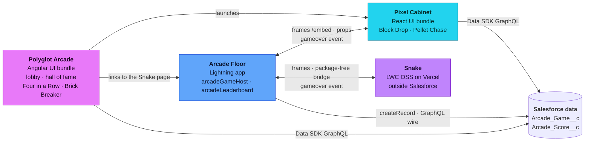

# 🕹️ Polyglot Arcade

[](https://github.com/svierk/polyglot-arcade/actions/workflows/ci.yml)
[](https://svierk.github.io/polyglot-arcade/)
[](https://github.com/svierk/polyglot-arcade/releases/latest)
[](LICENSE)


A retro arcade that runs on the Salesforce Platform and shows **Salesforce Multi-Framework** end to end: an **Angular** app and a **React** app live side by side in one org, share the same CRM data and embed into Lightning pages as **microfrontends** - next to an **LWC OSS** game that is hosted outside Salesforce altogether.

Every finished round is stored as an `Arcade_Score__c` record. Leaderboards, high scores and play counts are ordinary Salesforce data: sharing, field-level security and roll-up summaries do the work, no custom backend required.

<a href="https://svierk.github.io/polyglot-arcade/"></a>

## 🏗️ The architecture at a glance



The Angular hub is the only lobby, the React cabinet is a machine it launches and Lightning frames, and the Arcade Floor app is where microfrontends are composed. Every surface has its own color and room, and every game is a machine of its own. The [documentation](https://svierk.github.io/polyglot-arcade/) explains it all:

- [Concepts](https://svierk.github.io/polyglot-arcade/concepts) - Salesforce Multi-Framework in a nutshell
- [Architecture](https://svierk.github.io/polyglot-arcade/architecture/) - surfaces and roles, the four [integration patterns](https://svierk.github.io/polyglot-arcade/architecture/patterns), [communication](https://svierk.github.io/polyglot-arcade/architecture/communication) and the [data model](https://svierk.github.io/polyglot-arcade/architecture/data-model)
- [Games](https://svierk.github.io/polyglot-arcade/games) - five games, three frameworks, one machine each
- [Deploy](https://svierk.github.io/polyglot-arcade/deploy/) - prerequisites, setup, upgrade and troubleshooting
- [Build your own game](https://svierk.github.io/polyglot-arcade/build-your-own-game) - in the hub, in the cabinet or as an external guest
- [Decisions](https://svierk.github.io/polyglot-arcade/decisions/) - the architecture decision records

## 🚀 Quickstart

You need an org on **Winter '27** or later with Salesforce Multi-Framework (Hyperforce and English as the default language for the microfrontends), the [Salesforce CLI](https://developer.salesforce.com/tools/salesforcecli) and **Node.js 24**.

```bash
git clone https://github.com/svierk/polyglot-arcade.git
cd polyglot-arcade
npm install

sf org create scratch -f config/project-scratch-def.json -a polyglot-arcade -v <your-dev-hub> -y 7
npm run setup -- --target-org polyglot-arcade
```

`npm run setup` checks the org, builds and deploys both UI bundles and the metadata, assigns the permission set, seeds the games and connects the surfaces. It is safe to run again and keeps all scores. Then open **Polyglot Arcade** from the App Launcher. For an existing org, an upgrade and troubleshooting, see [Deploy](https://svierk.github.io/polyglot-arcade/deploy/).

## 🗺️ What's next

v1.0.0 completes the road planned in the milestone issues [#15](https://github.com/svierk/polyglot-arcade/issues/15) to [#19](https://github.com/svierk/polyglot-arcade/issues/19); the [releases](https://github.com/svierk/polyglot-arcade/releases) tell the story. Ideas for later: a spike in which the Angular hub hosts the React cabinet itself (possibly a fifth pattern), a public arcade on Experience Cloud (trade-show lead capture) and an Agentforce question like "who is this week's champion?". Localization and installation via package are not planned: they add complexity to a Multi-Framework demo without showing more of it.

## 🤝 Contributing

Contributions are welcome - new games, fixes and ideas for further integration patterns. Please read the [contributing guide](CONTRIBUTING.md) first; security issues go through the [security policy](SECURITY.md). [Development](https://svierk.github.io/polyglot-arcade/development) has the dev servers, tests and checks.

## 📄 License

[MIT](LICENSE) © Sebastiano Schwarz. Parts of the project tooling and the UI kits are derived from Salesforce's project templates under the BSD 3-Clause License, and the machines use fonts under the SIL Open Font License, see [THIRD_PARTY_NOTICES.md](THIRD_PARTY_NOTICES.md).

This is a community project and is not affiliated with or endorsed by Salesforce.
