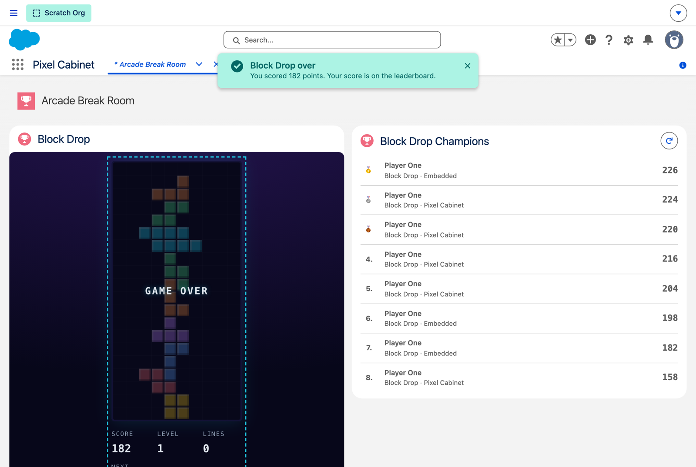
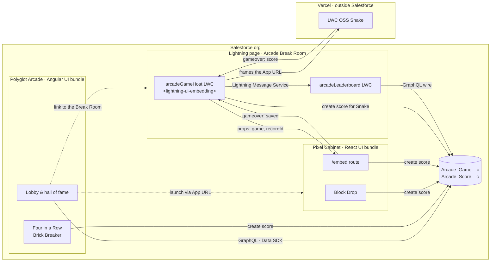
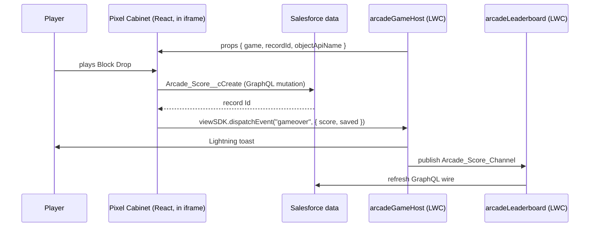
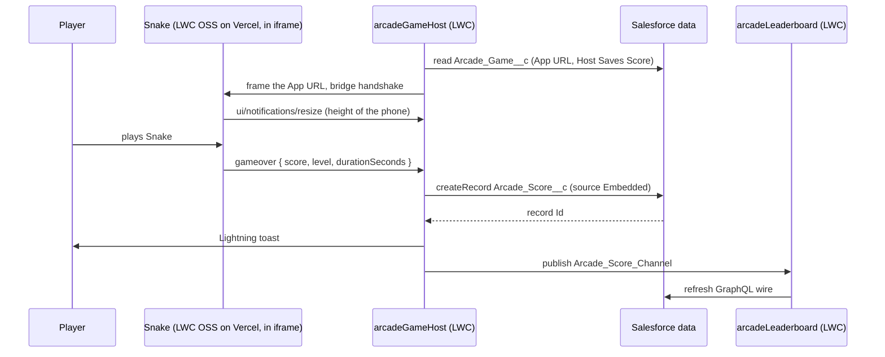
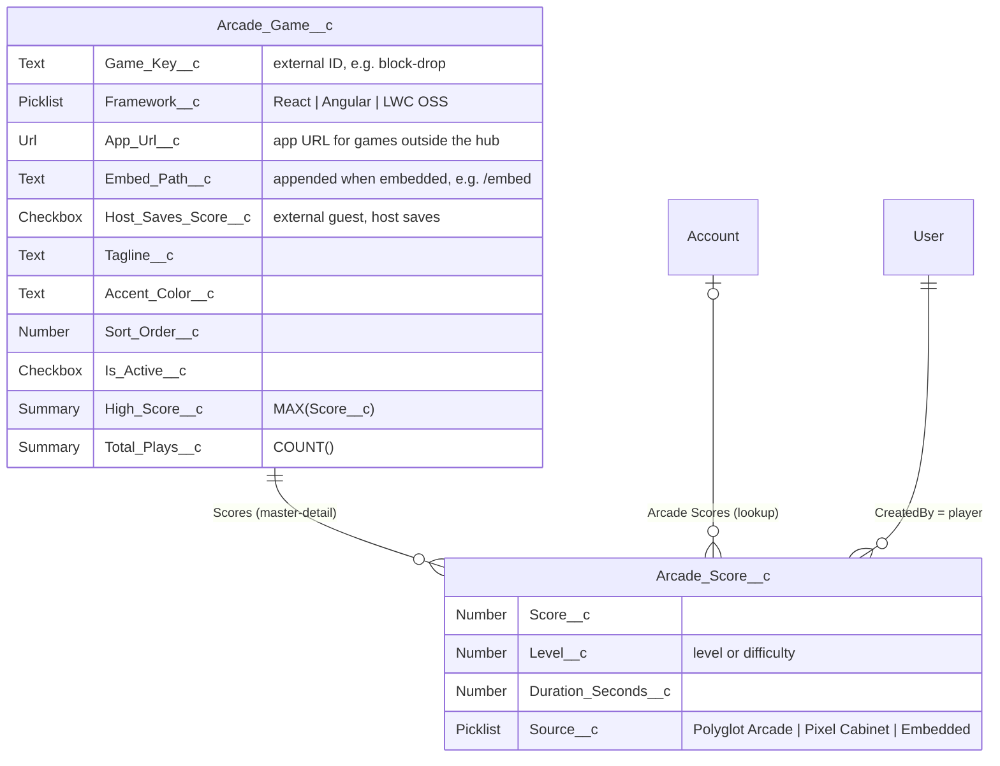

# 🕹️ Polyglot Arcade

[](https://github.com/svierk/polyglot-arcade/actions/workflows/ci.yml)
[](https://github.com/svierk/polyglot-arcade/releases/latest)
[](LICENSE)


A retro arcade that runs on the Salesforce Platform and shows **Salesforce Multi-Framework** end to end: an **Angular** app and a **React** app live side by side in one org, share the same CRM data and embed into Lightning pages as **microfrontends** - next to an **LWC OSS** game that is hosted outside Salesforce altogether.

Every finished round is stored as an `Arcade_Score__c` record. Leaderboards, high scores and play counts are ordinary Salesforce data: sharing, field-level security and roll-up summaries do the work, no custom backend required.

## 💡 The idea

Salesforce Multi-Framework lets teams build Salesforce apps with the frameworks they already know. Business demos of it tend to look alike - a list, a form, a detail page. Games stress a framework differently: a game loop, canvas rendering, keyboard focus inside an iframe, state that has to survive a reload as CRM data.

Polyglot Arcade turns that into a playful reference project:

- **Three frameworks, one platform.** The arcade hub is Angular, the real-time games run in a React "cabinet", and the [LWC OSS Snake](https://github.com/svierk/lwc-oss-snake-game) joins from Vercel. Each framework is used where it fits.
- **CRM data as the score sheet.** Every round becomes a record - visible in reports, in a native LWC leaderboard and in both apps.
- **Microfrontends in Lightning.** One host LWC drops any game onto a Lightning page, talks to it through events, and attributes rounds to the Account it is placed on. Games without a Salesforce session of their own get their score saved by the host.

## 🧩 Salesforce Multi-Framework in a nutshell

| Concept                             | What it means                                                                                                                                                                   | Where to look in this repo                                                                                                                                                                         |
| ----------------------------------- | ------------------------------------------------------------------------------------------------------------------------------------------------------------------------------- | -------------------------------------------------------------------------------------------------------------------------------------------------------------------------------------------------- |
| **UI bundle** (`UIBundle` metadata) | A React or Angular app built with its usual tooling, deployed as metadata and launched from the App Launcher on its own `*.salesforce.app` domain, isolated from Lightning      | [`uiBundles/polyglotArcade`](force-app/main/default/uiBundles/polyglotArcade) (Angular), [`uiBundles/pixelCabinet`](force-app/main/default/uiBundles/pixelCabinet) (React)                         |
| **Data SDK**                        | `createDataSDK()` from `@salesforce/platform-sdk`: UI API GraphQL queries and mutations with the user's session; object/field security and sharing are enforced by the platform | [`arcade-api.service.ts`](force-app/main/default/uiBundles/polyglotArcade/src/app/api/arcade-api.service.ts), [`arcadeApi.ts`](force-app/main/default/uiBundles/pixelCabinet/src/api/arcadeApi.ts) |
| **Microfrontend**                   | The `<lightning-ui-embedding>` base component frames an app inside an LWC on a Lightning page                                                                                   | [`arcadeGameHost`](force-app/main/default/lwc/arcadeGameHost)                                                                                                                                      |
| **View SDK**                        | Inside the frame, `getViewSDK()` reads the host's `props` and dispatches events back to the page                                                                                | [`hostBridge.ts`](force-app/main/default/uiBundles/pixelCabinet/src/embedding/hostBridge.ts)                                                                                                       |
| **Package-free bridge**             | The same host protocol without `@salesforce/platform-sdk` (`postMessage` handshake, then JSON-RPC over a `MessagePort`) for guests that cannot load the SDK                     | [`snake/embedding`](https://github.com/svierk/lwc-oss-snake-game/tree/main/src/modules/snake/embedding) in the Snake repo                                                                          |

React and Angular are generally available for UI bundles as of Winter '27. Embedding an **internally hosted** bundle (served from `*.salesforce.app`) is currently in beta and supports React; any **externally hosted** app can be embedded regardless of framework. That is why the embeddable games of the org live in the React cabinet - and why an LWC OSS app on Vercel can join as well.

## 🎮 Games

| Game              | Mechanic                                               | Framework | Lives in                                  | Status      |
| ----------------- | ------------------------------------------------------ | --------- | ----------------------------------------- | ----------- |
| **Block Drop**    | falling blocks, line clears, levels                    | React     | Pixel Cabinet                             | ✅ Playable |
| **Four in a Row** | turn-based vs. a minimax CPU with three difficulties   | Angular   | Polyglot Arcade hub                       | ✅ Playable |
| **Brick Breaker** | paddle and ball, tougher walls every level             | Angular   | Polyglot Arcade hub                       | ✅ Playable |
| **Snake**         | eat, grow, don't bite your own tail - on a retro phone | LWC OSS   | Vercel, embedded in the Arcade Break Room | ✅ Playable |
| **Pellet Chase**  | maze chase                                             | React     | Pixel Cabinet                             | 🚧 Planned  |

> The games are original implementations of classic mechanics. Names and artwork are deliberately generic - no trademarks of the original arcade titles are used.

| Four in a Row (Angular hub)                                                                                                  | Brick Breaker (Angular hub)                                                                                                                   |
| ---------------------------------------------------------------------------------------------------------------------------- | --------------------------------------------------------------------------------------------------------------------------------------------- |
|         |                                    |
| **Block Drop (React cabinet)**                                                                                               | **Microfrontend on a Lightning page**                                                                                                         |
|                      |  |
| **Hall of fame across all surfaces**                                                                                         |                                                                                                                                               |
|  |                                                                                                                                               |

## 🏗️ Architecture



The demo covers four integration patterns:

1. **Native Angular UI bundle.** `polyglotArcade` launches from the App Launcher and reads and writes data with the Data SDK. The lobby is data driven: tiles, colors, high scores and launch targets come from `Arcade_Game__c`.
2. **Native React UI bundle.** `pixelCabinet` runs standalone the same way, with its own routes and leaderboard.
3. **Internally hosted microfrontend - the guest saves.** The `arcadeGameHost` LWC frames the cabinet's `/embed` route. The cabinet has the user's session and saves the round itself. Admins pick the game in Lightning App Builder; on an Account record page every round is attributed to that Account.
4. **Externally hosted microfrontend - the host saves.** The same LWC frames the Snake on Vercel. The Snake has no Salesforce session, so it only reports the round and the host saves it with `createRecord`. The hub lobby links Snake to the Arcade Break Room, where it is played.

Which pattern applies comes from the game record: `App_Url__c` plus `Embed_Path__c` build the frame URL (`/embed` for the cabinet, nothing for the Snake), and `Host_Saves_Score__c` tells the host to save rounds itself.

What happens when an embedded cabinet round ends:



And when a Snake round ends:



LWR, the runtime of LWC OSS, cannot load `@salesforce/platform-sdk`, so the Snake speaks the [package-free bridge](https://developer.salesforce.com/docs/platform/microfrontend/guide/package-free-bridge.html) directly; its [README](https://github.com/svierk/lwc-oss-snake-game#embedding-in-salesforce) has the details. The host saves a Snake round only for the game record it embeds and only with a whole, non-negative score. Like with any game that runs in the browser, the score itself is what the game reports.

Game rules live in framework-free TypeScript (`games/*/engine.ts`) with their own unit tests; the React and Angular components only render and handle input.

### Data model



The permission set **Polyglot Arcade Player** (`polyglotArcade_Access`) grants both apps, read access to games and create/read access to scores. Players cannot edit or delete scores. Leaderboards only list scoring rounds; lost rounds still count as plays.

## 🚀 Deploy to your org

### Prerequisites

- An org on **Winter '27** or later with Salesforce Multi-Framework - a scratch org, a Developer Edition or a sandbox
- For the microfrontend: a **Hyperforce** org with **English** as the default language (requirements of `lightning-ui-embedding`)
- [Salesforce CLI](https://developer.salesforce.com/tools/salesforcecli) and **Node.js 24**

### Option A: Scratch org

```bash
git clone https://github.com/svierk/polyglot-arcade.git
cd polyglot-arcade
npm install

sf org create scratch -f config/project-scratch-def.json -a polyglot-arcade -v <your-dev-hub> -y 7
npm run setup -- --target-org polyglot-arcade
npm run connect:cabinet -- --target-org polyglot-arcade
```

### Option B: Any existing org

```bash
git clone https://github.com/svierk/polyglot-arcade.git
cd polyglot-arcade
npm install

sf org login web -a my-org        # Developer Edition, sandbox, ...
npm run setup -- --target-org my-org
npm run connect:cabinet -- --target-org my-org
```

`npm run setup` installs and builds both UI bundles, deploys the metadata, assigns the permission set to you, imports the five games and fetches the GraphQL schema. `npm run connect:cabinet` stores the org-specific Pixel Cabinet URL (read from its App Launcher entry) and its `/embed` route on the React games, so the hub can launch them and the host LWC can embed them. The Snake needs no extra step: its Vercel URL ships with the seed data and the CSP Trusted Site `Snake_Vercel` lets Lightning frame it.

> ⚠️ The data step of `npm run setup` re-imports the games. In an org that already has scores, this deletes them (they are master-detail children of the games). Run `npm run setup -- --target-org my-org --skip-data` for later deployments.

Then open **Polyglot Arcade** or **Pixel Cabinet** from the App Launcher, or the **Arcade Break Room** tab for the embedded Block Drop and Snake.

### Upgrade from v0.2.0

Keep your scores: deploy without the data step, store the cabinet's embed route on the React games and add the Snake record.

```bash
git pull && npm install
npm run setup -- --target-org my-org --skip-data
npm run connect:cabinet -- --target-org my-org
sf data create record -o my-org -s Arcade_Game__c -v "Name=Snake Game_Key__c=snake Framework__c='LWC OSS' Tagline__c='Eat, grow and never bite your own tail.' Sort_Order__c=50 Accent_Color__c=#c084fc App_Url__c=https://lwc-oss-snake-game.vercel.app Host_Saves_Score__c=true"
```

The host LWC is now called **Arcade Game Host** (`arcadeGameHost`). The Arcade Break Room switches over automatically. If you placed the old **Pixel Cabinet Host** on other pages, it keeps working there until you replace it with the new host (its **Cabinet URL** property is now called **App URL**) and delete it.

### Optional steps

- **More players:** `sf org assign permset -n polyglotArcade_Access -b <username> -o my-org`
- **Games on Account pages:** add **Arcade Game Host** (any game, including Snake) and **Arcade Leaderboard** to the Account record page in Lightning App Builder. Both pick up the record ID automatically, and the leaderboard shows only that Account's rounds.

### Troubleshooting

| Symptom                                                         | Fix                                                                                                                                                                                    |
| --------------------------------------------------------------- | -------------------------------------------------------------------------------------------------------------------------------------------------------------------------------------- |
| An embedded game stays blank or reports `HEARTBEAT_TIMEOUT`     | Check that the CSP Trusted Sites `PixelCabinet_SalesforceApp` (`https://*.salesforce.app`) and `Snake_Vercel` (`https://lwc-oss-snake-game.vercel.app`) are active, both for frame-src |
| The host shows "this game is not plugged in yet"                | Run `npm run connect:cabinet`, or paste the game's URL into the **App URL** field of its game record or into the host's **App URL** property                                           |
| The embedded cabinet shows the full cabinet instead of the game | The React games miss their **Embed Path** `/embed`: run `npm run connect:cabinet`                                                                                                      |
| A UI bundle does not open from the App Launcher                 | Enable **Salesforce Edge Network** in My Domain                                                                                                                                        |
| The lobby says it could not load games                          | Assign the **Polyglot Arcade Player** permission set                                                                                                                                   |

## 🛠️ Development

Each UI bundle is a regular Angular or React project with its own `package.json`:

```bash
cd force-app/main/default/uiBundles/pixelCabinet && npm run dev     # React cabinet (Vite)
cd force-app/main/default/uiBundles/polyglotArcade && npm run dev   # Angular hub
```

Both dev servers proxy data calls to your default org (`sf config set target-org=polyglot-arcade`). To embed a local game in Lightning while you iterate, deploy the development-only trusted sites for the cabinet (`http://localhost:5173`) and the Snake (`yarn dev` in the Snake repo, `http://localhost:3000`) and set the host's **App URL** to the dev server:

```bash
sf project deploy start --source-dir dev
```

Chrome's Local Network Access checks can block a Salesforce page from framing `localhost` (`ERR_BLOCKED_BY_LOCAL_NETWORK_ACCESS_CHECKS`); allow local network access for the org's domain in the site settings.

Tests and checks - the [Validation workflow](.github/workflows/ci.yml) runs all of them on every push and pull request, no org required:

| Scope         | Command                                                                                    | What it covers                                            |
| ------------- | ------------------------------------------------------------------------------------------ | --------------------------------------------------------- |
| SFDX project  | `npm run prettier:verify` · `npm run lint` · `npm run test:unit`                           | formatting, LWC linting, LWC Jest + accessibility (sa11y) |
| React cabinet | `npm run lint` · `npx vitest run` · `npm run build:e2e && npx playwright test`             | Block Drop engine, production build, end-to-end play      |
| Angular hub   | `npm run build` · `npx ng test --watch=false` · `npm run build:e2e && npx playwright test` | game engines, lobby launch targets, end-to-end play       |

GraphQL operations are validated against your org's schema with `npm run graphql:codegen` inside each bundle.

## 📁 Project structure

```
force-app/main/default/
├── uiBundles/
│   ├── polyglotArcade/       Angular hub: lobby, hall of fame, Four in a Row, Brick Breaker
│   └── pixelCabinet/         React cabinet: Block Drop, /embed microfrontend route
├── lwc/
│   ├── arcadeGameHost/       <lightning-ui-embedding> host, event bridge, saves external rounds
│   └── arcadeLeaderboard/    native LWC leaderboard (GraphQL wire + LMS refresh)
├── objects/                  Arcade_Game__c, Arcade_Score__c
├── messageChannels/          Arcade_Score_Channel
├── flexipages/, tabs/        Arcade Break Room app page
├── cspTrustedSites/          frame-src for *.salesforce.app and the Snake on Vercel
├── permissionsets/           Polyglot Arcade Player
├── applications/             Polyglot Arcade and Pixel Cabinet apps
└── data/                     seed data for the games (imported by npm run setup)
dev/                          development-only metadata (localhost trusted sites)
scripts/                      org setup, project setup, connect-cabinet
```

## 🗺️ Roadmap

- **v0.4.0** - Pellet Chase (React)
- **v1.0.0** - localization, installation via package, mobile and accessibility polish
- **Later** - a public arcade on Experience Cloud (trade-show lead capture) and an Agentforce question like "who is this week's champion?"

## 🤝 Contributing

Contributions are welcome - new games, fixes and ideas for further integration patterns. Please read the [contributing guide](CONTRIBUTING.md) first; security issues go through the [security policy](SECURITY.md).

## 📄 License

[MIT](LICENSE) © Sebastiano Schwarz. Parts of the project tooling and the UI kits are derived from Salesforce's project templates under the BSD 3-Clause License, see [THIRD_PARTY_NOTICES.md](THIRD_PARTY_NOTICES.md).

This is a community project and is not affiliated with or endorsed by Salesforce.
