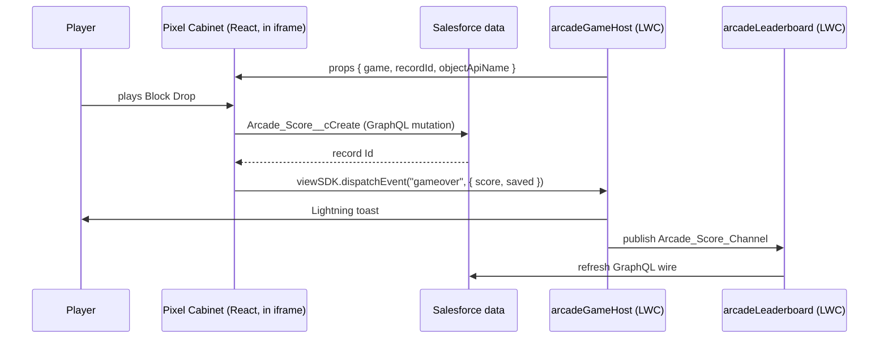
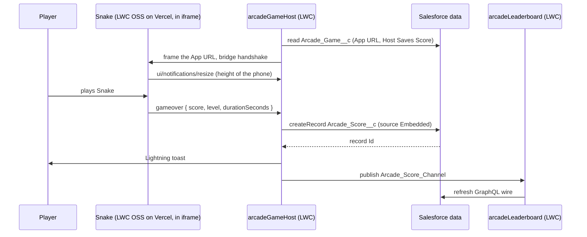
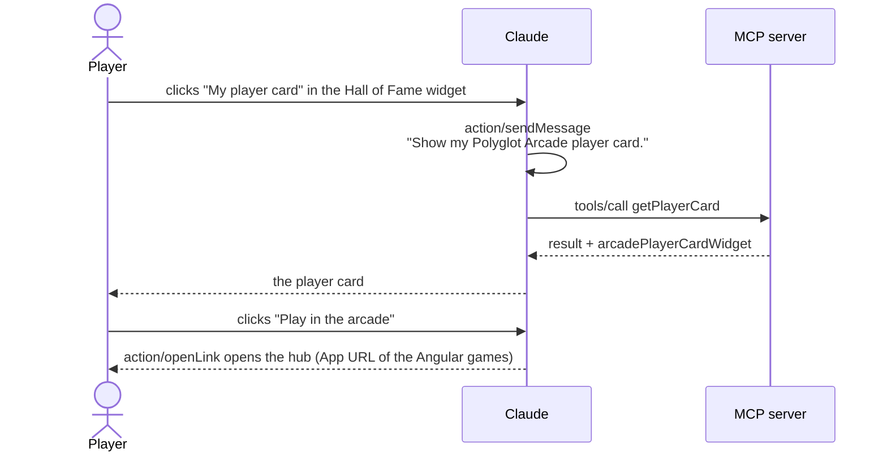

# Communication

Five channels connect the arcade. Each one has a single job:

| Channel                                                 | Between                                 | Carries                                                     |
| ------------------------------------------------------- | --------------------------------------- | ----------------------------------------------------------- |
| [Data SDK GraphQL](#data-sdk-graphql)                   | UI bundles → Salesforce data            | game records, leaderboards, new scores                      |
| [View SDK props and events](#view-sdk-props-and-events) | host LWC ↔ framed cabinet               | which game to show and for which record; the end of a round |
| [Package-free bridge](#package-free-bridge)             | host LWC ↔ framed external guest        | the same protocol, without `@salesforce/platform-sdk`       |
| [Lightning Message Service](#lightning-message-service) | host LWC → other components on the page | "a round was saved", so leaderboards refresh                |
| [MCP and HXL widgets](#mcp-and-hxl-widgets)             | AI client ↔ MCP server → Apex tools     | questions as tool calls, results as data and as a widget    |

The LWCs read data with the `lightning/graphql` wire and write with `lightning/uiRecordApi`, like any Lightning component. The headless surface reads with Apex invocable actions in user mode.

## Data SDK GraphQL

Both UI bundles talk to Salesforce through `createDataSDK()` from `@salesforce/platform-sdk`. It sends UI API GraphQL with the player's session, so object and field security and sharing apply. No Apex class is involved.

A round is saved with one mutation - the cabinet's [`arcadeApi.ts`](../../force-app/main/default/uiBundles/pixelCabinet/src/api/arcadeApi.ts) as an example:

```graphql
mutation CabinetCreateScore($input: Arcade_Score__cCreateInput!) {
  uiapi {
    Arcade_Score__cCreate(input: $input) {
      Record {
        Id
      }
    }
  }
}
```

with `Game__c`, `Score__c`, `Level__c`, `Duration_Seconds__c`, `Source__c` and - on an Account page - `Account__c` as input. Reads that show scores skip the SDK's query cache (`cacheControl: 'no-cache'`): scores change with every round, on any surface and for every player.

Every GraphQL operation is checked against the org's schema: `npm run graphql:codegen` in each bundle fetches the schema and generates TypeScript types for the operations.

## View SDK props and events

When the `arcadeGameHost` LWC frames the cabinet with `<lightning-ui-embedding>`, the two talk through the View SDK:

- **host → guest: `props`.** The host passes `{ game, recordId, objectApiName }`. The cabinet reads them with `getViewSDK()` → `getUiState()` and subscribes to changes, so it switches games without a reload ([`hostBridge.ts`](../../force-app/main/default/uiBundles/pixelCabinet/src/embedding/hostBridge.ts)).
- **guest → host: `gameover`.** After a round the cabinet dispatches a `gameover` event with `{ gameKey, gameName, score, level, saved, isHighScore }`. Unless `saved` is true, the round did not reach Salesforce, and the host says so in its toast.

Off an embedding surface `getViewSDK()` resolves to an empty SDK, so the cabinet works the same when it is launched standalone.

### An embedded cabinet round {#embedded-cabinet-round}



## Package-free bridge

LWR, the runtime of LWC OSS, cannot load `@salesforce/platform-sdk`. The Snake therefore implements the guest side of the [package-free bridge](https://developer.salesforce.com/docs/platform/microfrontend/guide/package-free-bridge.html) itself: a `postMessage` handshake, then JSON-RPC 2.0 over a `MessagePort`. The host side is the same `<lightning-ui-embedding>` as for the cabinet - the host cannot tell the two guests apart.

```
host LWC (Salesforce)                         Snake (in an iframe)
    │  iframe src ...?hostMetaData={hostAppOrigin, instanceId}
    │ ◄──────────────────── sf-embedding/ready (window message to hostAppOrigin only)
    │ ── sf-embedding.bootstrap + MessagePort ────────► checked: origin, parent, instanceId, one port
    │                       JSON-RPC 2.0 over the port
    │ ── ui/notifications/host-initialized ───────────►
    │ ◄──────────────── ui/notifications/embedding-initialized
    │ ◄──────────────── ui/subscribe/ui-state            (host props)
    │ ◄──────────────── ui/notifications/resize          (height of the game)
    │ ◄──────────────── ui/events/dispatch  gameover
```

The guest only becomes active when it is framed and its URL carries the `hostMetaData` parameter that `<lightning-ui-embedding>` appends; opened on its own, the game behaves as before. The [Snake's README](https://github.com/svierk/lwc-oss-snake-game#embedding-in-salesforce) has the details.

### An embedded Snake round {#embedded-snake-round}



The host saves a guest's round only for the game record it embeds, whatever game key the guest reports, and only with a whole, non-negative score. On an Account page it fills `Account__c` with the record ID of the page.

## Lightning Message Service

After a saved round the host publishes `{ gameKey, score }` on the message channel `Arcade_Score_Channel`. Every `arcadeLeaderboard` on the same page subscribes to it and refreshes its GraphQL wire. On an Account page the leaderboard picks up the record ID and lists only that Account's rounds.

The host and the leaderboard know nothing about each other beyond the channel: any component on the page can listen, and the leaderboard works next to any host - or none.

## MCP and HXL widgets

AI clients reach the arcade through the custom MCP server `polyglotArcade`, hosted by Salesforce. The client signs the player in with OAuth and calls a tool; the server runs the Apex invocable action behind it as that player and returns the result twice - as data the model reads, and as the input of the HXL widget linked to the tool, which the client renders as an MCP App. The full sequence is on [Headless surface](/architecture/headless#from-a-question-to-a-widget).

The widgets talk back through two actions, without client-specific code:



The widgets never write: rounds are saved on the other surfaces, through the Data SDK and the host LWC.
