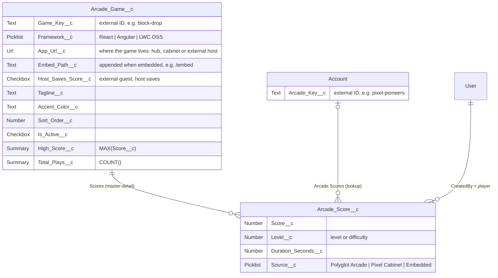

# Data model

Two custom objects hold the whole arcade. Leaderboards, high scores and play counts are ordinary Salesforce data - no custom backend.

## Arcade Game

One record per game. The record is the configuration of the game: the lobby builds its cards from it, the host LWC builds its frame from it, and the [Tech X-ray](/architecture/patterns#tech-x-ray) derives the integration pattern from it.

| Field                                                            | Purpose                                                                                                |
| ---------------------------------------------------------------- | ------------------------------------------------------------------------------------------------------ |
| `Game_Key__c`                                                    | Unique external ID, e.g. `block-drop`. The bundles' game registries and the seed data use the same key |
| `Framework__c`                                                   | `React`, `Angular` or `LWC OSS`                                                                        |
| `App_Url__c`                                                     | Where the game lives. Stored per org by the setup for the hub and cabinet games; shipped for the Snake |
| `Embed_Path__c`                                                  | Appended to the App URL when Lightning frames the game - `/embed` for the cabinet games                |
| `Host_Saves_Score__c`                                            | The game has no Salesforce session; the host LWC saves its rounds                                      |
| `Tagline__c`, `Accent_Color__c`, `Sort_Order__c`, `Is_Active__c` | What the lobby shows, in which order, and whether at all                                               |
| `High_Score__c`                                                  | Roll-up summary: the best score of all rounds                                                          |
| `Total_Plays__c`                                                 | Roll-up summary: the number of rounds                                                                  |

The seed data ([`Arcade_Game__c.json`](../../force-app/main/default/data/Arcade_Game__c.json)) holds the five games. `npm run setup` upserts them by `Game_Key__c`, so a second run updates the games in place and their scores survive.

## Arcade Score

One record per finished round, the child of its game (master-detail). The player is the record's creator.

| Field                 | Purpose                                                                                            |
| --------------------- | -------------------------------------------------------------------------------------------------- |
| `Score__c`            | The final score                                                                                    |
| `Level__c`            | Level reached, or the difficulty for turn-based games                                              |
| `Duration_Seconds__c` | Time played                                                                                        |
| `Source__c`           | Where the round was played: `Polyglot Arcade`, `Pixel Cabinet` or `Embedded` (on a Lightning page) |
| `Account__c`          | The Account of the record page the round was played on, if any                                     |

Leaderboards only list scoring rounds; lost rounds still count as plays.

## Showcase Account

Rounds played on an Account page belong to that Account. So that this is visible in every org, the seed data ([`Account.json`](../../force-app/main/default/data/Account.json)) holds one fictional customer, **Pixel Pioneers Inc.** The setup upserts it by the custom field `Account.Arcade_Key__c` (external ID, `pixel-pioneers`) - like the games, it is updated in place on every run and its rounds survive.

- The hub lobby looks the Account up by its key and links its Arcade Account page from the cabinet games.
- The list view **Arcade Accounts** on the Accounts tab lists every Account with an Arcade Key.

## Access

The permission set **Polyglot Arcade Player** (`polyglotArcade_Access`) grants the two UI bundle apps and Arcade Floor, read access to games, Accounts and their Arcade Key, and create and read access to scores. Players cannot edit or delete scores. Everything else - which scores a player sees, which fields - is the platform's sharing and field-level security, enforced in every surface because all of them read through UI API.

## Reports and dashboard

The report folder **Polyglot Arcade** holds three reports on the report type _Arcade Games with Scores_ - **Top scores per game**, **Plays per framework** and **Rounds per source** - and the dashboard **Arcade Floor** charts all three. Both folders are shared with all internal users, and the dashboard shows each viewer the data they can see. Arcade Floor has the Reports and Dashboards tabs.
