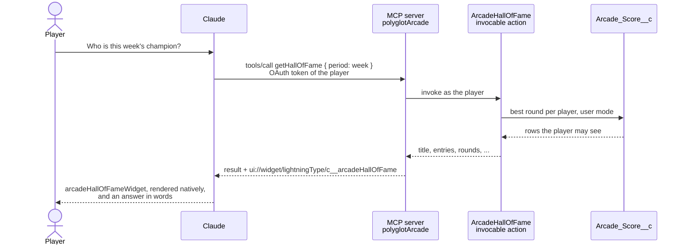

# Headless surface

Players ask, the arcade answers in the chat. The **headless surface** brings the Hall of Fame and a player card to AI clients such as Claude and ChatGPT - without a UI bundle, a Lightning page or frontend code of its own. It is built with the Salesforce **Headless Experience Layer** (HXL, beta): a widget is declared once in JSON, and every client that supports MCP Apps renders it natively.


The other surfaces show the same data in three frameworks. This one shows it with no UI of its own: the arcade only says what to show, and the client decides how it looks. [ADR 0003](/decisions/0003-headless-surface) has the reasons.

## From a question to a widget



The MCP server is hosted by Salesforce at `api.salesforce.com`. The client signs the player in with OAuth, so every call runs as that player. The tool result carries the data twice: as structured content, which the model reads to answer in words, and as the input of the widget the tool is linked to.

## The two tools

| Tool            | Input                                                                                                                                                                       | Shows                                                                                                                                                                                           |
| --------------- | --------------------------------------------------------------------------------------------------------------------------------------------------------------------------- | ----------------------------------------------------------------------------------------------------------------------------------------------------------------------------------------------- |
| `getHallOfFame` | `game` - key or name, forgiving case, spaces and hyphens (`brick-breaker`, `Brick Breaker`); empty for all games<br/>`period` - `today`, `week`, `month` or `all` (default) | With a game, its top 10 players by their best round; without one, the champion of every game. Players with the same best share a rank. Buttons: **Play in the arcade** and **My player card**   |
| `getPlayerCard` | `player` - a name; empty for the person who asks                                                                                                                            | The player's best round and rank in every game they played, how many of the games that is, and their last five rounds, with dates in the asker's locale and time zone. Button: **Hall of Fame** |

The Hall of Fame here ranks **players**, one row each with their best round. The hall of fame in the hub ranks **rounds**. In a chat, "who is the champion?" is a question about players.


The buttons use the two actions HXL offers: `action/openLink` opens the hub from the **App URL** that the setup stores on the Angular games, and `action/sendMessage` posts a new message as the player, for example _"Show my Polyglot Arcade player card."_ The client answers it with the other tool, so the widgets lead to each other without a line of client-specific code.

The screenshots show the widgets as the HXL renderer draws them, which the MCP server delivers to the client as an MCP App. In the client they follow its theme, light or dark.

## Building blocks

Six kinds of metadata make the surface. All of them are deployed by `npm run setup`.

| Piece       | Metadata                                                                                              | Job                                                                                                                                                                                                            |
| ----------- | ----------------------------------------------------------------------------------------------------- | -------------------------------------------------------------------------------------------------------------------------------------------------------------------------------------------------------------- |
| Tools       | Apex `ArcadeHallOfFame`, `ArcadePlayerCard`, with `ArcadeScoreStats`                                  | Invocable actions that read `Arcade_Score__c`. Lists of rows are global inner classes (`ArcadeHallOfFame.Entry`) with `@AuraEnabled` fields                                                                    |
| Widgets     | `UiWidgetBundle` `arcadeHallOfFameWidget`, `arcadePlayerCardWidget`                                   | The composition: `tile/*` components, `forEach` over the rows, `if` for empty states, formulas such as `FORMATNUMBER`, and a `schema.json` with the attributes the widget accepts                              |
| Types       | `LightningTypeBundle` `arcadeHallOfFame` and `arcadeHallOfFameResponse`, the same for the player card | The response type mirrors the action's outputs. The envelope type models the tool result (`actionName`, `isSuccess`, `outputValues`), and its `renderer.json` maps `outputValues.*` to the widget's attributes |
| MCP server  | `McpServerDefinition` `polyglotArcade`                                                                | The two tools, read-only and idempotent, each linked by `uiResource` to its widget resource `ui://widget/lightningType/c__<type>`                                                                              |
| Sign-in     | `ExternalClientApplication` `polyglotArcadeMcp` with its OAuth settings and policies                  | OAuth for MCP clients: scopes MCP and refresh token, PKCE, JWT-based access tokens, no client secret, Claude's callback URL                                                                                    |
| Beta switch | `Settings` `UiWidget`                                                                                 | Turns on the Headless Experience Layer. The setup deploys it before everything else - an org checks widget bundles before it applies settings from the same deploy                                             |

The setup's connect step then activates the MCP server - an `McpServerAccess` record, which the server's metadata has no field for - and prints its URL and the OAuth client ID. See [Connect Claude](/deploy/#connect-claude).

## Same data, same rules

- **The player, not an integration user.** The MCP client acts with the OAuth token of the player who signed in. `getPlayerCard` without a name is the asker's own card.
- **Sharing and field-level security.** The Apex classes are `with sharing` and query `WITH USER_MODE`, so a player sees in the chat exactly what the hub shows them.
- **One permission set.** **Polyglot Arcade Player** grants access to the two tool classes. Without it, the MCP server lists no tools.
- **Read-only.** Both tools only read. Rounds are still played and saved on the other surfaces.

## Limits of the beta

- HXL is a beta service. It needs API version 67.0 or later and is turned on per org.
- Widgets render in clients that support MCP Apps - Claude and ChatGPT. Slackbot shows them unless it uses Block Kit.
- A widget shows data and offers buttons; it has no input fields. Interaction goes through `sendMessage` and `openLink`.
- One request per call. The tool input is a list (`inputs: [ ... ]`, the shape of an invocable action), but a widget renders only a single result - a call that bundles several periods returns text only. The tool descriptions tell the model to call once per period, game or player.
- After a widget changes in the org, a client can show the old version for a while.

## Where each piece lives

```
force-app/main/default/
├── classes/                  ArcadeHallOfFame, ArcadePlayerCard, ArcadeScoreStats, ArcadeToolsTest
├── uiWidgets/                arcadeHallOfFameWidget, arcadePlayerCardWidget
├── lightningTypes/           arcadeHallOfFame(+Response), arcadePlayerCard(+Response)
├── mcpServerDefinitions/     polyglotArcade
├── externalClientApps/       Polyglot Arcade MCP, with extlClntApp* OAuth settings and policies
└── settings/                 UiWidget (HXL on)
```
