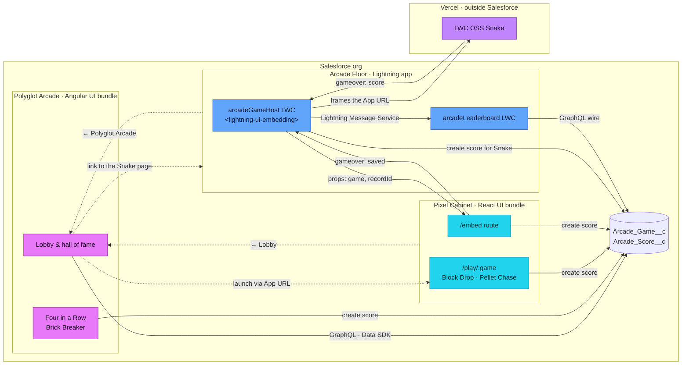

# Surfaces and roles

Polyglot Arcade runs on three surfaces in one org, plus one guest outside of it. Every surface has one role ([ADR 0001](/decisions/0001-surface-roles)) and a color of its own ([ADR 0002](/decisions/0002-surfaces-and-machines)).



Solid arrows carry data and events, dotted arrows are links a player follows.

## The surfaces

| Surface                                                                | Room                | Role                                                                                                                                                                                                                                            |
| ---------------------------------------------------------------------- | ------------------- | ----------------------------------------------------------------------------------------------------------------------------------------------------------------------------------------------------------------------------------------------- |
| <span class="surface hub">Polyglot Arcade</span><br/>Angular UI bundle | magenta arcade hall | The only lobby and hall of fame, and the entry point. It launches every game, wherever it lives.                                                                                                                                                |
| <span class="surface cabinet">Pixel Cabinet</span><br/>React UI bundle | cyan machine room   | A machine, not a second hub. It has no lobby: opening it sends the player to the hub lobby. The hub launches its games at `/play/<game>`, Lightning frames them at `/embed`.                                                                    |
| <span class="surface floor">Arcade Floor</span><br/>Lightning app      | blue                | Where microfrontends are composed: the **Snake** page with the Snake and its leaderboard, and the **Arcade Account** record page (app default for Accounts) with the cabinet and the Account's leaderboard. Rounds there count for the Account. |

The Snake is a guest, not a surface: an [LWC OSS game](https://github.com/svierk/lwc-oss-snake-game) on Vercel, without a Salesforce session of its own. It is played embedded on its page in the Arcade Floor.

Three platform facts shape these roles:

1. **Internally hosted embedding** (beta) of a UI bundle via `<lightning-ui-embedding>` supports React only, so the embeddable games live in the React bundle.
2. **Composition happens in Lightning.** `lightning-ui-embedding` is an LWC base component; a UI bundle cannot host another bundle by platform means.
3. **UI bundles run outside Lightning** on the org's `*.salesforce.app` domain, each with its own App Launcher entry.

## Two halls, one bar

Every standalone page starts with the same marquee bar, which stays on top while the page scrolls: `← Lobby` and a badge naming the surface (`Angular · Polyglot Arcade hub`, `React · Pixel Cabinet UI bundle`). The footer below adds `Salesforce ↗` (the way out to the Arcade Floor app in Lightning), the player and `Log out`; these replace the platform's session banner, which both bundles switch off with `<meta name="sf-session-banner" content="disabled">`.

The bar is laid out the same everywhere but glows in the color of its surface, and the room below it is the surface's own: the hub is a magenta arcade hall, the cabinet a cyan machine room. Lobby cards, launch buttons and the hall of fame use the same colors to say where a game lives and where a round was played, and the embedded cabinet carries a slim `React · Pixel Cabinet UI bundle` tag inside the Lightning frame. A switch between bundles is visible instead of feeling like a break.

Below the bar, every game is a machine of its own - see [Games](/games).

## Navigation between the surfaces

| From → to       | How                                                                                                                                          |
| --------------- | -------------------------------------------------------------------------------------------------------------------------------------------- |
| Hub → cabinet   | The **App URL** on the React game records, stored by the setup's connect step                                                                |
| Hub → Lightning | The org URL plus `/lightning/app/c__arcadeFloor/n/<tab>`, so the page opens inside the Arcade Floor app; `Salesforce ↗` opens the app itself |
| Cabinet → hub   | Derived from the cabinet's own base path: both bundles share one origin, so the cabinet swaps its app name for the hub's                     |
| Lightning → hub | The `← Polyglot Arcade` action on the Arcade Game Host card, from the App URL of the Angular game records                                    |

Both bundles are served from the same origin, for example `https://<my-domain>--c.<...>.salesforce.app/app/c__pixelCabinet` and `/app/c__polyglotArcade`. An org-relative URL such as `/lightning/app/c__polyglotArcade` does not launch a UI bundle - Lightning needs the bundle's `*.salesforce.app` URL, which is only exposed as the start URL of the app's App Launcher entry. That is why the [setup](/deploy/) reads it and stores it on the game records.

## Where each piece lives

```
force-app/main/default/
├── uiBundles/
│   ├── polyglotArcade/       Angular hub: lobby, hall of fame, Four in a Row, Brick Breaker
│   └── pixelCabinet/         React cabinet: Block Drop, Pellet Chase, /embed microfrontend route
├── lwc/
│   ├── arcadeGameHost/       <lightning-ui-embedding> host, event bridge, saves external rounds
│   └── arcadeLeaderboard/    native LWC leaderboard (GraphQL wire + LMS refresh)
├── objects/                  Arcade_Game__c, Arcade_Score__c
├── messageChannels/          Arcade_Score_Channel
├── flexipages/, tabs/        Snake app page, Arcade Account record page
├── cspTrustedSites/          frame-src for *.salesforce.app and the Snake on Vercel
├── permissionsets/           Polyglot Arcade Player
├── applications/             Polyglot Arcade and Pixel Cabinet (UI bundles), Arcade Floor (Lightning)
├── reportTypes/, reports/    Arcade Games with Scores, three reports in the Polyglot Arcade folder
├── dashboards/               Arcade Floor dashboard
└── data/                     seed data for the games (upserted by npm run setup)
```

Next: the [four integration patterns](/architecture/patterns) that connect these surfaces to the platform.
