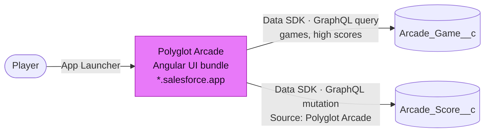
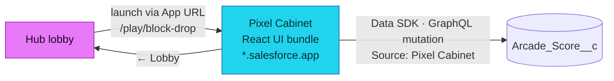
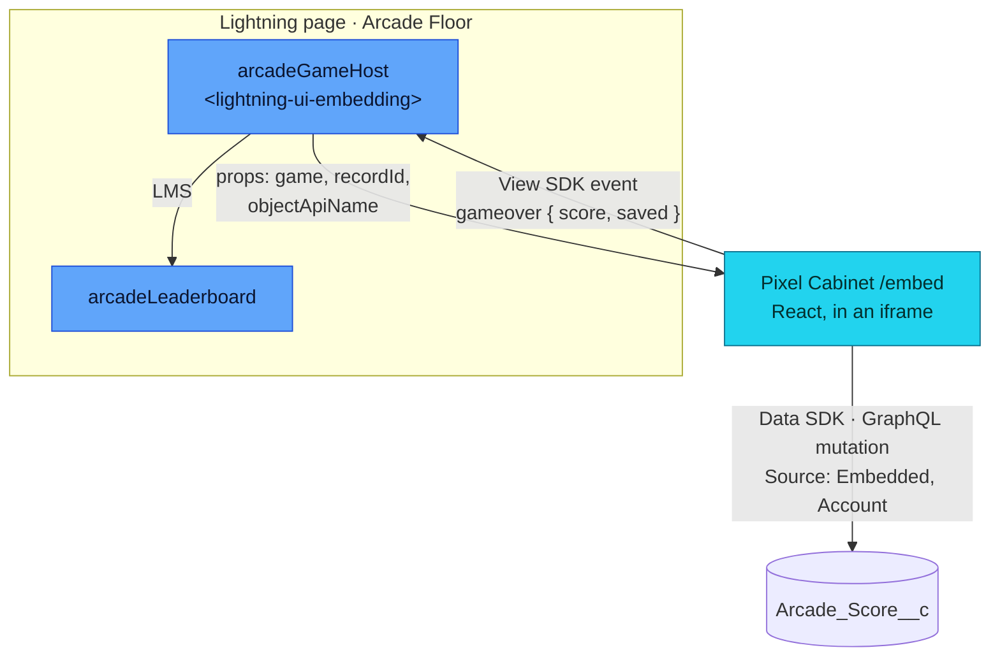
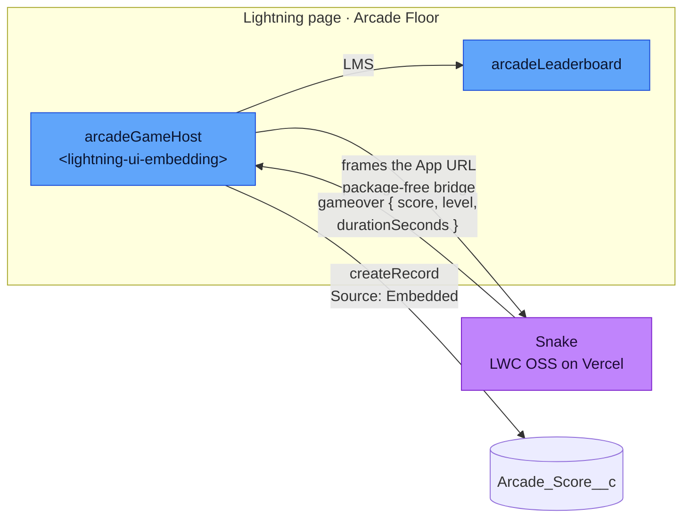

# Integration patterns

Polyglot Arcade covers four ways a game reaches the Salesforce Platform. The numbers and names are the same everywhere: on this page, in the Tech X-ray of the running app and in the footer of the Arcade Game Host card.

| #   | Pattern                                                         | Game                                         | Who saves the round                     |
| --- | --------------------------------------------------------------- | -------------------------------------------- | --------------------------------------- |
| 1   | [Native Angular UI bundle](#pattern-1)                          | Four in a Row, Brick Breaker                 | the hub, with the player's session      |
| 2   | [Native React UI bundle](#pattern-2)                            | Block Drop, Pellet Chase                     | the cabinet, with the player's session  |
| 3   | [Internally hosted microfrontend - the guest saves](#pattern-3) | Block Drop, Pellet Chase on a Lightning page | the framed cabinet, as guest            |
| 4   | [Externally hosted microfrontend - the host saves](#pattern-4)  | Snake on its Lightning page                  | the host LWC - the guest has no session |

## 1 · Native Angular UI bundle {#pattern-1}

`polyglotArcade` launches from the App Launcher and reads and writes data with the Data SDK. The lobby is data driven: tiles, colors, high scores and launch targets come from `Arcade_Game__c`.

The bundle is a regular Angular project. `createDataSDK()` from `@salesforce/platform-sdk` sends UI API GraphQL with the player's session, so object and field security and sharing apply as in Lightning.

## 2 · Native React UI bundle {#pattern-2}

`pixelCabinet` runs standalone the same way, with its own routes and leaderboard. It is launched from the hub lobby and has no lobby of its own.

The launch target is the **App URL** of the React game record, which the setup stores for the org. Opening the cabinet without a game sends the player back to the hub lobby.

## 3 · Internally hosted microfrontend - the guest saves {#pattern-3}

The `arcadeGameHost` LWC frames the cabinet's `/embed` route. The cabinet has the player's session and saves the round itself. Admins pick the game in Lightning App Builder; on an Account record page such as **Arcade Account** every round is attributed to that Account.

The setup seeds the showcase Account **Pixel Pioneers Inc.**, and the hub lobby links its page from Block Drop and Pellet Chase - _or embedded on the Pixel Pioneers Inc. Account page ↗_. Rounds played there show up in the Account's leaderboard and carry the Account on the score record.

Inside the frame, the cabinet reads the host's `props` with the View SDK and switches games without a reload. After the round it tells the host whether it was saved; the host shows a toast and refreshes the leaderboards on the page. The full sequence is on [Communication](/architecture/communication#embedded-cabinet-round).

## 4 · Externally hosted microfrontend - the host saves {#pattern-4}

The same LWC frames the Snake on Vercel. The Snake has no Salesforce session, so it only reports the round and the host saves it with `createRecord`. The hub lobby links Snake to its page on the Arcade Floor, where it is played.

LWR, the runtime of LWC OSS, cannot load `@salesforce/platform-sdk`, so the Snake speaks the [package-free bridge](https://developer.salesforce.com/docs/platform/microfrontend/guide/package-free-bridge.html) directly. The host saves a Snake round only for the game record it embeds and only with a whole, non-negative score. Like with any game that runs in the browser, the score itself is what the game reports.

## Which pattern applies

Nothing is configured per game beyond its `Arcade_Game__c` record:

| Field                 | Effect                                                                                             |
| --------------------- | -------------------------------------------------------------------------------------------------- |
| `Framework__c`        | `Angular` means pattern 1 (the game lives in the hub), `React` pattern 2 (it lives in the cabinet) |
| `App_Url__c`          | Where the game lives: the hub, the cabinet or the external host                                    |
| `Embed_Path__c`       | Appended to the App URL when Lightning frames the game (`/embed` for the cabinet), plus pattern 3  |
| `Host_Saves_Score__c` | The guest has no session: pattern 4, the host saves the round                                      |

## Tech X-ray

The patterns are visible in the running app, under the same names and numbers:

- **Lobby.** The **Tech X-ray** switch in the hub's marquee bar turns every game card into a blueprint: pattern, framework, surface, who saves the score and the data path. The switch is remembered per browser.
- **Badge.** On every page of the hub and the cabinet, the badge in the marquee bar opens the X-ray of the surface on screen: pattern 1 in the hub, pattern 2 in the cabinet.
- **Lightning.** The footer of the **Arcade Game Host** card names the pattern that runs in its frame: pattern 3 for a cabinet game, pattern 4 for the Snake.

Each X-ray links to this page. Nothing is written down per game: the hub derives the X-ray from the game record ([`xray.ts`](../../force-app/main/default/uiBundles/polyglotArcade/src/app/xray.ts)) - `Host_Saves_Score__c` means pattern 4, an Angular game pattern 1, a React game pattern 2, plus pattern 3 when it has an `Embed_Path__c`. A new game record gets its X-ray without a code change.
