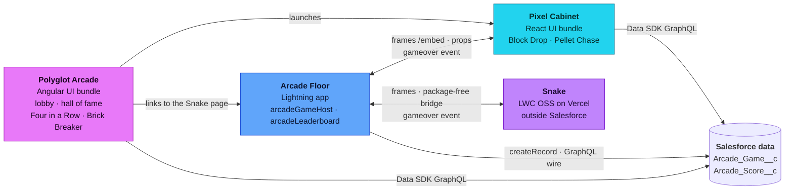

## The architecture at a glance

One Salesforce org is the hall. Three surfaces stand in it, each in a color of its own, and one machine stands outside: the Snake on Vercel. The arrows are everything they say to each other and to the data they share.

- Polyglot Arcade is the only lobby and the hall of fame. It launches every game, wherever the game lives.
- Pixel Cabinet is a machine, not a second hub. The hub launches its games, and Lightning frames them as a microfrontend.
- Arcade Floor is where microfrontends are composed: the Snake page and the Account page with the embedded cabinet.

Every finished round becomes a record. Read on in [Surfaces and roles](/architecture/), or [deploy the arcade](/deploy/) into your own org with one command.

